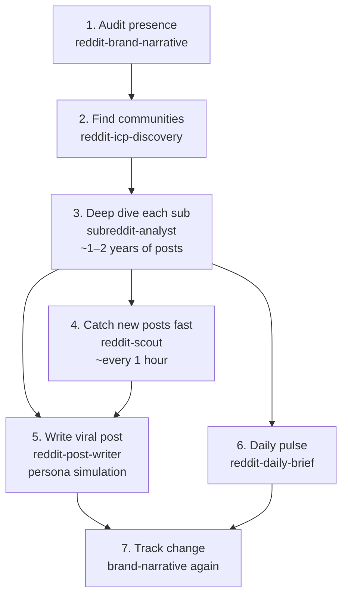

# Reddit Skills

**Give this repo one try.** It’s the same framework that took me from getting banned over and over on Reddit — to **50M+ views**, including a single post with **12M+ views and 10K+ upvotes**.

I didn’t start with a playbook. I burned through **tens of Reddit accounts**, guessed what worked, and watched posts die (or get me banned). Then I rebuilt the process: research each subreddit on its own, write for that community only, simulate before posting. We ran this framework again and again across **multiple products**. The numbers above are what came out after a lot of iteration — not a lucky one-off.

I almost didn’t open-source this. The toolkit is powerful enough that it *could* be misused (including for unethical stuff like trying to manipulate markets or people). I debated that for a long time. I’m sharing it anyway because the same system can help builders show up honestly in communities that matter — **please use it ethically. Don’t misuse it.**

These six skills are for agents (Claude Code, Codex, and similar). Use them alone or as a pipeline: find where your audience hangs out → study each subreddit → watch live threads → draft posts that sound human.

> Reddit is not one audience. What works in one subreddit can flop in another. Research first. Post second.

## Skills at a glance

| Skill | What it actually does |
| --- | --- |
| [`reddit-brand-narrative`](reddit-brand-narrative/) | Audit how Reddit talks about your brand or product, community by community, over a fixed date range. |
| [`reddit-icp-discovery`](reddit-icp-discovery/) | Find subreddits where your ideal customer and their problem already show up. Shortlist + evidence, then hand each one to `subreddit-analyst`. |
| [`subreddit-analyst`](subreddit-analyst/) | Pull **1–2 years** of posts from one subreddit (often **hundreds of thousands** of posts via Arctic Shift), then break down topics, norms, risks, and whether your product fits. One subreddit at a time — never mixed. |
| [`reddit-scout`](reddit-scout/) | Watch named subreddits on a short loop (**e.g. every hour**) for posts about you, your product, or topics you care about. Scores relevance and can draft reply comments — it does **not** post. |
| [`reddit-post-writer`](reddit-post-writer/) | Draft an AI post for **one** subreddit, then **stress-test it with digital-twin personas** (7 reviewers) before you see it. One subreddit = one post. Built to sound human, not like an ad. |
| [`reddit-daily-brief`](reddit-daily-brief/) | Morning automation: harvest last-24h posts from configured subs, analyze, build a PDF brief, email it (default 7 AM HKT harvest). Needs local setup. |

Each folder has its own `SKILL.md` with inputs, steps, and limits.

## How to use these skills (in order)



1. **Audit your presence** — Use `reddit-brand-narrative` to see how Reddit already talks about your brand, product, or narrative (community by community).
2. **Find communities** — Use `reddit-icp-discovery` to find the subreddits where your customers actually live and discuss their problems.
3. **Deep dive each subreddit** — Use `subreddit-analyst` on one sub at a time. Pull ~**1–2 years** of past posts, learn how that community behaves, what they like / hate, and everything your agent needs to win that subreddit.
4. **Catch new posts fast** — Use `reddit-scout` to find relevant new posts as soon as they appear (about you, your product, or topics you care about). Typical loop: check across your target subs about **every 1 hour** so you can steer the narrative early.
5. **Write the viral post** — Use `reddit-post-writer` to draft a post that does **not** sound like AI, aimed at **one** specific subreddit. It **simulates the post with digital-twin personas before you post**.
6. **Daily pulse** — Use `reddit-daily-brief` for a morning digest of what customers are saying about your product, or what’s happening in the communities you care about.
7. **Track change** — Run `reddit-brand-narrative` again later on a comparable date range to see if the story on Reddit shifted.

Skip what you don’t need. Brand-new product with zero mentions? Start at step 2.

## Quick start

Copy this repo link into **Claude Code** or **Codex**, then tell the agent what you want in plain language. It will pick the right skill(s) and run them.

```text
https://github.com/ndpvt-web/reddit-skills
```

**Examples of what to say**

> Audit how Reddit talks about **[brand/product]** over the last **[N months]**. Use the skills in this repo.

> Find subreddits where **[customer]** discusses **[problem]** for **[product]**. Then deep-dive the best ones with ~1–2 years of data.

> Every hour, check **r/[subs]** for new posts about **[brand/topic]** and draft replies — don’t post.

> Write a viral post for **r/[subreddit]** about **[situation]**. Simulate with personas first. Goal: **[…]**.

> Give me a daily brief on what people are saying about **[product]** (or in **r/[subs]**).

Optional: clone and install a single skill folder into `~/.claude/skills` or `~/.codex/skills` if you prefer local copies.

## Results

- **50M+ views** using this framework (across multiple products, after a lot of iteration)
- Highest single post: **12M+ views** and **10K+ upvotes**
- Every post was **written by AI**, aimed at **one specific subreddit**
- Always research that sub first (`subreddit-analyst`) — **never** reuse the same post across subs

Give it one serious run on a real product and a real subreddit. That’s the test.

**Use it ethically.** Don’t use this to manipulate markets, deceive communities, or run astroturf campaigns.

## Contributing

Ideas we want next (PRs welcome):

1. **Content calendar dashboard** — plan and track posts across subreddits from one place.
2. **Dynamic / per-subreddit personas** — today `reddit-post-writer` simulates a fixed set of 7 agent personalities; make personas dynamic or tuned to each community.
3. **Strategy playbook (or separate skill)** — document tactics such as:
   - product comparison posts
   - indirect product mentions inside a viral topic or an opinionated post about something else
   - other approaches that usually come out of `subreddit-analyst` from past data (what that community likes / doesn’t like)

Keep skills reusable across brands. Do not commit credentials, cookies, tokens, or private run outputs.
